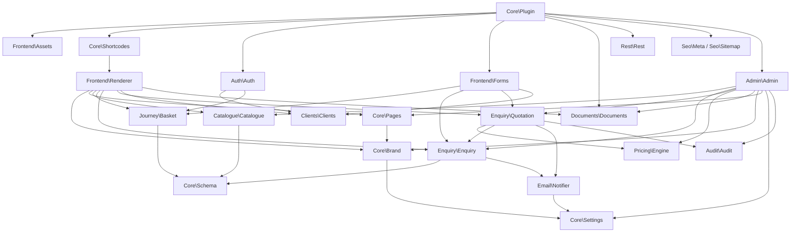

# BMTG Private Journey — Architecture

Version: 1.0.0  
Plugin file: `bmtg-private-journey/bmtg-private-journey.php`  
Namespace root: `BMTG\PrivateJourney\`  
Text domain: `bmtg-private-journey`

## Design principles

- Independent plugin. It does not load, modify or depend on the BMTG Business Manager chatbot.
- Modular PHP classes, each in `includes/{Module}/class-{name}.php`, loaded by a namespace autoloader.
- WordPress APIs for users, capabilities, options, pages, cron-free scheduling, HTTP, mail and REST.
- Custom tables for catalogue, journeys, enquiries, quotations, documents and audit history.
- Branding is read from one settings service (`Core\Settings` + `Core\Brand`), never hardcoded.
- Server-side pricing and permissions; supplier cost/margin never reach the client renderer.
- Quotation acceptance records intent only; it never implies supplier confirmation.

## Module map

```
bmtg-private-journey.php
├── includes/Core/
│   ├── class-autoloader.php    Namespace → file autoloader
│   ├── class-plugin.php        Bootstrap + service wiring
│   ├── class-activator.php     Capabilities, schema, install marker
│   ├── class-deactivator.php   Flush rewrites (data preserved)
│   ├── class-schema.php        Table names, statuses, sanitisation helpers
│   ├── class-migrations.php    dbDelta schema + category/sequence seeds
│   ├── class-capabilities.php  Capability + role matrix
│   ├── class-settings.php      One option array, per-section sanitising
│   ├── class-brand.php         Branding service (logo, colours, social, CSS vars)
│   ├── class-pages.php         Page registry, mapping, explicit page creation
│   └── class-shortcodes.php    [bmtg_pj_*] registration
├── includes/Clients/           Client profile persistence
├── includes/Auth/              Email login, registration, Google ID token, onboarding
├── includes/Catalogue/         Catalogue CRUD, query, service-specific validator
├── includes/Journey/           Basket/drafts, journey-wide validator
├── includes/Enquiry/           Enquiry lifecycle, versioned quotations
├── includes/Pricing/           Server-side totals, tax, discount, margin
├── includes/Email/             Internal-only notification emails + dedupe log
├── includes/Documents/         Protected storage, authenticated downloads
├── includes/Audit/             Append-only audit log
├── includes/Rest/              Permission-checked REST endpoints
├── includes/Seo/               Canonical, meta, JSON-LD, core sitemap provider
├── includes/Frontend/          Assets, POST handlers, shortcode renderer
├── includes/Admin/             Staff admin menus, screens and handlers
├── assets/                     Public CSS/JS, admin CSS/JS
└── uninstall.php               Explicit data removal
```

## Request lifecycle

1. `plugins_loaded` → `Core\Plugin::boot()`.
2. Version check runs `Core\Migrations`; capabilities are installed on activation/upgrade only.
3. Modules register hooks: assets, shortcodes, auth, forms, documents, REST, SEO, admin.
4. A shortcode calls `Frontend\Renderer`, which reads through `Catalogue`, `Basket`,
   `Enquiry`, `Quotation`, `Clients` and `Documents`. Output is escaped.
5. POST actions go to `admin-post.php` handlers (`Frontend\Forms`), which verify nonces,
   check login/capability, mutate data, write audit entries and redirect with status codes.
6. Staff actions go to `Admin` handlers with capability + nonce checks.

## Dependency diagram



## Data model

All tables use the WordPress prefix and `bmtg_pj_` prefix:

| Table | Purpose |
|---|---|
| `bmtg_pj_clients` | Client profile linked to a WP user (nullable) |
| `bmtg_pj_client_preferences` | Key/value travel preferences |
| `bmtg_pj_catalogue_categories` | Editable catalogue categories |
| `bmtg_pj_catalogue_items` | All service types in one catalogue |
| `bmtg_pj_service_options` | Priced or POA options per item |
| `bmtg_pj_suppliers` | Supplier directory |
| `bmtg_pj_journey_drafts` | Basket/draft header (client or guest token) |
| `bmtg_pj_journey_items` | Basket lines with service-specific fields |
| `bmtg_pj_enquiries` | One RFQ per submission |
| `bmtg_pj_enquiry_items` | Immutable snapshot of requested services |
| `bmtg_pj_quotation_versions` | Versioned proposals, totals, status |
| `bmtg_pj_quotation_items` | Versioned pricing lines |
| `bmtg_pj_confirmed_journeys` | Journey after acceptance (not a supplier booking) |
| `bmtg_pj_reservations` | Future reservation records |
| `bmtg_pj_documents` | Metadata for protected files |
| `bmtg_pj_notifications` | Email audit + duplicate prevention |
| `bmtg_pj_audit_logs` | Actor/action/object audit trail |
| `bmtg_pj_sequences` | Atomic-ish enquiry/journey reference sequences |

Schema version is stored in `bmtg_pj_db_version` and managed by `Core\Migrations`.
Migrations are additive `dbDelta` statements and are safe to re-run.

## Journey basket behaviour

- Guests receive an HTTP-only, SameSite=Lax cookie containing a random token.
- A guest draft is stored against that token; logged-in drafts are stored against `client_id`.
- Adding to the basket is allowed for guests; saving a journey or submitting an enquiry requires login.
- On login/registration, a guest draft is linked to the client and the guest token is rotated/cleared.
- Basket lines keep service-specific fields (dates, rooms, pax, pickup/dropoff, flight number, notes).
- `Journey\Validator` checks hotel overlaps, missing transfers, timing conflicts, missing pax,
  missing flight details and service-specific required fields. Warnings never remove selections.

## Quotation workflow

```
new → review → supplier_check → pricing → internal_approval
    → proposal_issued → client_response → accepted/declined
    → reservation → confirmed → closed
```

- Each quotation is a new version. Issuing supersedes the previous issued version.
- Totals are computed server-side by `Pricing\Engine` from cost, selling price, quantity,
  discount, tax and currency. Unknown selling price stays `Price on Request`.
- Client acceptance sets the quotation to accepted and creates a confirmed journey with
  `pending_supplier_confirmation`. It never sets a reservation or supplier status automatically.
- Internal notes, supplier cost and margin are never rendered in client templates.

## Branding propagation

`Core\Brand` is the only branding source. It supplies:

- Logo URLs and display width.
- Company name, address, phone, email, website, registration.
- Primary/secondary/accent/background/text colours and font stacks.
- WhatsApp URL with encoded number and message.
- Instagram/Facebook/email/phone links with individual enable switches.
- CSS custom properties injected on the frontend.

Shortcodes, email templates, dashboard, catalogue, basket, enquiry, quotations, documents and
concierge all read from this service. Public website branding is not touched.